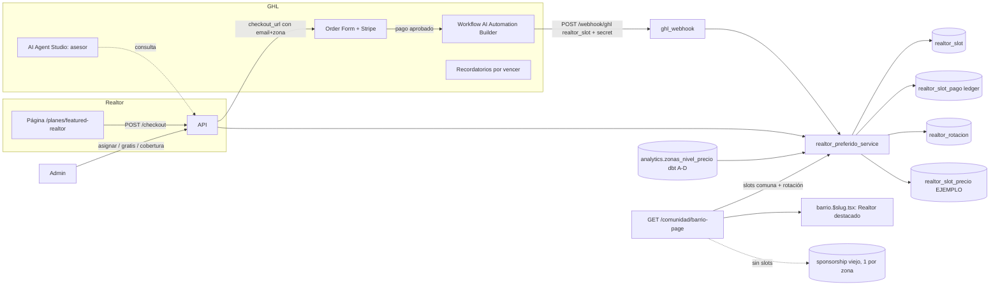

# Auditoría — Realtor Preferido (2026-11-20)

Alcance: compatibilidad con el schema y código existentes, rendimiento, concurrencia, seguridad y huecos de negocio.
**Límite honesto:** no hay DB local ni Docker. Nada se ejecutó contra Postgres; la compatibilidad se verificó leyendo las migraciones existentes. 9 tests de lógica pasan con conexión simulada.

## Diagrama

## Corregido en esta pasada (commit pendiente)

| # | Hallazgo | Arreglo |
|---|---|---|
| 1 | Idempotencia por `pago_ref` no atómica y se perdía tras una renovación (el `pago_ref` se sobrescribe) → un reenvío podía extender dos veces | Tabla `realtor_slot_pago` (PK `pago_ref`), insert atómico en la misma transacción |
| 2 | Slot de un agente que pasa a `inactivo`/`pendiente` seguía en la rotación y el hueco quedaba vacío en la UI | `slots_activos` ahora une con `agent.estado='activo'` |
| 3 | `/siguiente` exponía el teléfono del realtor a cualquiera (scraping) | Quitado el campo |
| 4 | Se podía cobrar/asignar un slot en una zona inexistente (código mal escrito en GHL) | `validar_zona` en checkout, admin y webhook |
| 5 | Barrio con `posicion` 5-8 permitido por la DB (solo el código lo impedía) | CHECK `chk_realtor_slot_cap` |
| 6 | Webhook: pago cobrado sin slot (zona llena) solo devolvía 409 | `logger.error` con `pago_ref` para alertar |

## Compatibilidad verificada (leyendo migraciones)

- Un solo head alembic (0123 sobre 0122). `gen_random_uuid()` ya se usa en 0045/0058.
- `agent`: UUID, `estado` enum (se castea a texto), `email`, `usuario_id`, `bio` (0098), `foto_url`. `agency_member`, `agent_review.calificacion` existen.
- `raw.barrios.id` SERIAL, `municipio`, `nombre` existen; `zona_codigo` barrio = `id::text` igual que sponsorship.
- `analytics.zonas_nivel_precio` es dbt: puede no existir en DEV → hay try/except y nivel por defecto "C".
- **Sin verificar:** que el SQL corra (sin DB). Primer paso en DEV: `alembic upgrade head`.

## Resuelto después (sin verificar contra DB)

- Hueco 1: la página de barrio recibe `barrio_id` y mezcla slots de barrio + comuna.
- Hueco 2: nueva landing `/planes/featured-realtor` con selector de zona y checkout.
- Hueco 3: migración 0124 + cron `realtor_slots` (siembra 1 gratis por barrio con el realtor "casa"; falta marcar quién es con `POST /realtor-preferido/admin/casa`).
- Hueco 6: rotación por ventana de tiempo (20 s), sin escrituras por vista.
- Hueco 8: cron diario vence slots, sincroniza `agent.tier` y avisa por email 5 días antes.

## Huecos abiertos (ordenados por impacto)

1. **Los slots de BARRIO no se muestran en ningún lado.** La página de barrio solo consulta slots de comuna. Se venden 4 por barrio pero el producto no los muestra. Falta pasar `barrio_id` a `/comunidad/barrio-page` y mezclar barrio+comuna.
2. **No hay UI de compra ni de admin.** `/planes/featured-realtor` sigue siendo el flujo viejo; solo existen endpoints. El realtor no puede elegir zona ni comprar desde el sitio.
3. **Slots gratis de arranque no están automatizados.** "Todo barrio con ≥1 preferido" depende de que alguien llame a `admin/asignar` y no está en migración/cron (regla del proyecto: debe vivir en carril versionado). Además no está definido *quién* es el realtor gratis.
4. **Cobro sin slot:** si la zona se llena entre el checkout y el pago, Stripe ya cobró. Hace falta un workflow GHL en la rama 409 (tarea + reembolso) y, mejor, reservar el cupo al iniciar el checkout.
5. **Recurrencia vs `meses`:** el slot dura 30 días × `meses`, pero el producto de GHL es mensual recurrente. Falta decidir: ¿suscripción (cada cobro = +30 días) o pago por N meses? Un pago fallido deja el slot activo hasta `fecha_fin`.
6. **Rotación escribe en cada vista.** `GET barrio-page` hace un UPSERT a una fila por comuna: contención en comunas muy visitadas y se rompe si hay CDN/caché delante (la rotación se congela). Alternativa barata: rotar por ventana de tiempo (sin escritura). Hoy no hay caché en el endpoint (verificado en código).
7. **Dos sistemas conviven** (sponsorship 1/zona y slots): hay que decidir si el viejo se retira; hoy los slots lo reemplazan en la UI solo si la comuna tiene slots.
8. **Vencimiento sin cron:** las consultas ya filtran por `fecha_fin`, así que lo mostrado es correcto, pero el `estado` solo se actualiza al asignar o al ver cobertura. Falta cron + aviso "por vencer" (el workflow GHL lo cubre si recibe `slot_fecha_fin`; hoy nadie se la manda).
9. **Precios son EJEMPLO** (`es_ejemplo=TRUE`); sin la tabla real no se puede lanzar. Las 4 definiciones por confirmar siguen en `DECISION_REALTOR_PREFERIDO.md` ("Kona"=comuna, Stripe vía GHL, quién es el gratis, desplazamiento).
10. **Realtor sin cuenta urbi** que paga en GHL → el webhook da 404 y el dinero queda cobrado. Requiere registro previo obligatorio (el checkout ya lo exige, el Order Form directo no).
11. **Tests:** la suite del repo no corre localmente (faltan `httpx`/deps); no hay test de integración con DB real ni del endpoint. Ejecutar en CI/DEV.
12. **Rate limit:** `/precios` y los endpoints de realtor/admin no tienen límite propio (los de admin exigen auth; `/precios` es barato).
13. **i18n:** no se tocó frontend, así que el escaneo de i18n no aplica aún; la UI futura debe usar `t('es','en')`.
14. **Fuera de este cambio pero relacionado:** emails de visitas, `notify_*`, cron de recordatorios, realtor de prueba en DEV (pendientes del mapa de procesos).

## Próximo paso único

En DEV: `alembic upgrade head`, luego `POST /api/v1/realtor-preferido/admin/asignar` con un agente, y abrir una página de barrio de esa comuna.
